# Paso a paso: del fork a tu agente en internet

Guía para seguir en clase, pantalla por pantalla. Las capturas son del panel de Cloudflare y de Vercel al
22-10-2026. Los números rojos de cada captura corresponden a los números del texto.

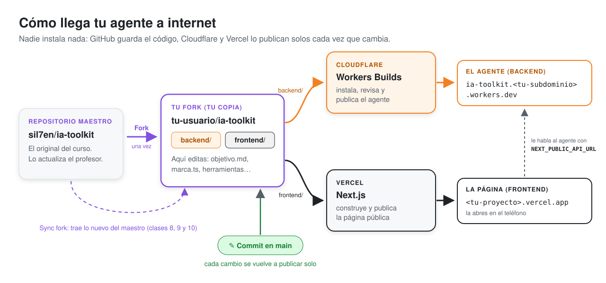

**Antes de empezar, ten a mano:**

- Tus cuentas de **GitHub**, **Cloudflare** y **Vercel**, con sesión iniciada en el mismo navegador.
- La **clave de Gemini** de tu equipo (te la entrega el profesor).
- Una **clave de aprobación**: una frase que invente tu equipo, por ejemplo `pauta-del-viernes`. Sirve para
  aprobar borradores.

| Paso | Qué haces | Tiempo |
|---|---|---|
| 0 | Fork: tu copia del repositorio | 1 min |
| 1 | Cloudflare: publicar el agente | 5 min |
| 2 | Cloudflare: guardar las dos claves | 3 min |
| 3 | Primera corrida del agente | 1 min |
| 4 | Vercel: publicar la página | 5 min |
| 5 | Anotar tus direcciones | 1 min |

---

## 0. El fork: tu copia del repositorio

1. Abre **github.com/sil7en/ia-toolkit**.
2. Arriba a la derecha, aprieta **Fork**.
3. En la pantalla siguiente no cambies nada: el nombre debe seguir siendo `ia-toolkit`. Aprieta **Create fork**.

✅ **Punto de control:** estás en `github.com/<tu-usuario>/ia-toolkit` y ves las carpetas `backend`,
`frontend` y `docs`.

---

## 1. Cloudflare: publicar el agente

Entra a **dash.cloudflare.com**.

### 1.1 Crear la aplicación

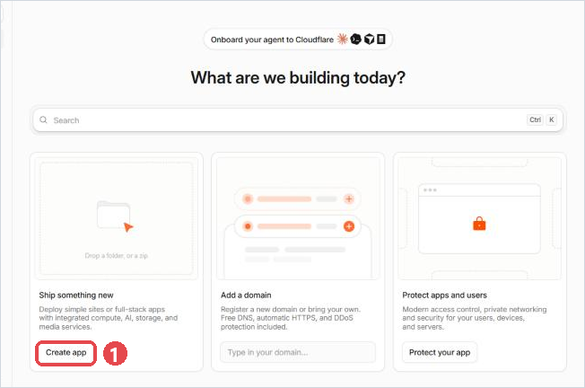

En la pantalla **What are we building today?**, aprieta **Create app** ①.

> Si tu cuenta ya tenía algo creado, el inicio se ve distinto: entra por el menú izquierdo a
> **Compute → Workers & Pages** y aprieta **Create application**.

### 1.2 Conectar GitHub

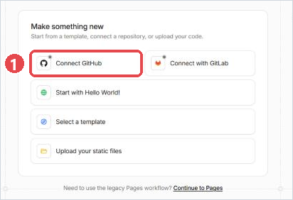

Aprieta **Connect GitHub** ①. Se abre GitHub para que autorices a Cloudflare:

1. Elige **Only select repositories**.
2. En la lista, elige **ia-toolkit**.
3. Aprieta **Install & Authorize**. Vuelves a Cloudflare.

> Si ya habías conectado GitHub antes, el botón dice **Continue with GitHub**. Si después `ia-toolkit` no
> aparece en la lista, falta darle permiso: en GitHub ve a **Settings → Applications → Cloudflare Workers and
> Pages → Configure**, agrega `ia-toolkit` y aprieta **Save**.

### 1.3 Elegir tu repositorio

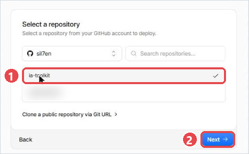

Haz clic en **ia-toolkit** ① (aparece un ✓) y aprieta **Next** ②.

### 1.4 Revisar el nombre

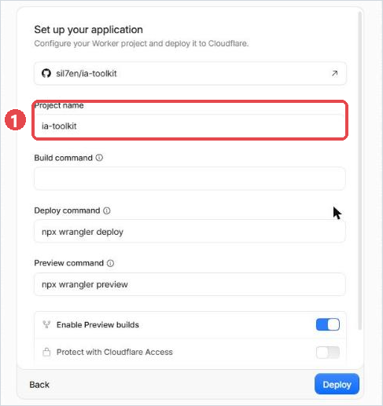

En **Project name** ① ya viene escrito `ia-toolkit`. **No lo cambies**: ese nombre tiene que coincidir con el
que tiene el código. Tampoco toques **Build command**, **Deploy command** ni **Preview command**.

### 1.5 El único dato que escribes: la carpeta `backend`

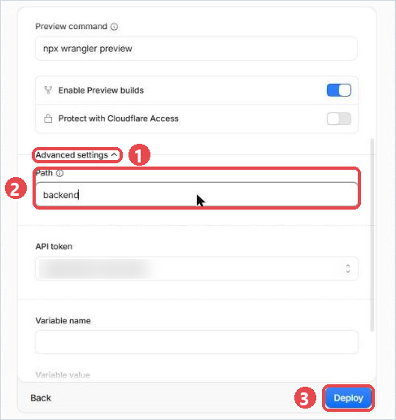

Baja hasta el final del formulario:

1. Abre **Advanced settings** ① (es un texto pequeño, con una flechita).
2. En **Path** ② borra la `/` y escribe **`backend`** (en minúsculas, sin barras).
3. Aprieta **Deploy** ③.

> ⚠ Este es el paso que más se olvida. Si **Path** queda en `/`, el build falla porque Cloudflare no encuentra
> el agente. Se arregla en el Worker → **Settings → Builds → Build configuration** → **Root directory** =
> `backend`; luego, en la pestaña **Deployments**, abre el build fallido y aprieta **Retry build**.

### 1.6 Esperar el build (alrededor de 1 minuto)

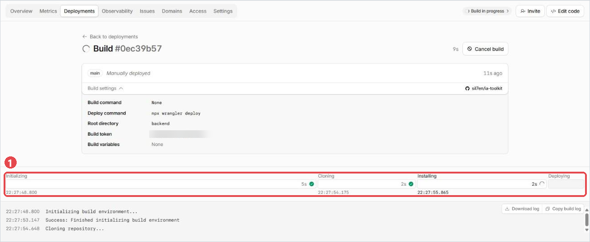

Cloudflare pasa por cuatro etapas ①: **Initializing → Cloning → Installing → Deploying**. Cada una se pone en
verde al terminar. En el ensayo tardó 47 segundos.

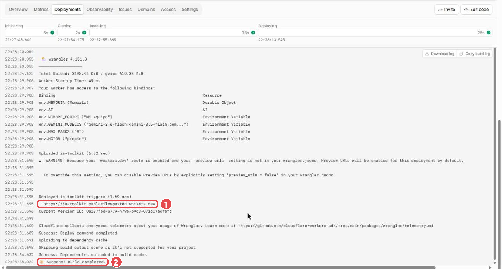

Al final del registro aparece la dirección de tu agente ①, `https://ia-toolkit.<tu-subdominio>.workers.dev`, y
la línea **Success! Build completed.** ②. Copia la dirección.

> Si Cloudflare te pide elegir un **subdominio workers.dev** (en cuentas nuevas puede pasar la primera vez),
> escribe algo corto y tuyo, por ejemplo tu usuario de GitHub. Ese subdominio queda en tu dirección.

✅ **Punto de control:** abre `https://ia-toolkit.<tu-subdominio>.workers.dev/` en otra pestaña. Debe decir
`"estado": "en línea"` y `"modelo": "simulado (sin clave de Gemini)"`. Que diga *simulado* es lo esperado:
todavía no le das la clave.

---

## 2. Cloudflare: guardar las dos claves

Las claves (secretos) no van en GitHub: se guardan en Cloudflare, cifradas.

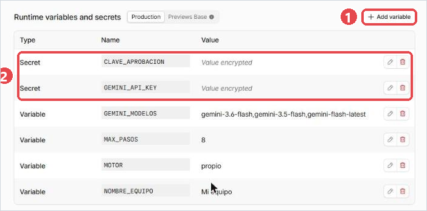

1. En tu Worker `ia-toolkit`, entra a la pestaña **Settings**.
2. En **Runtime variables and secrets**, aprieta **Add variable** ①.

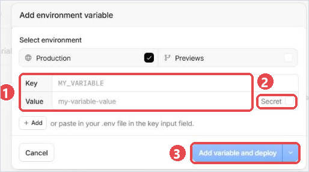

3. En el cuadro **Add environment variable** deja marcado **Production**. Escribe ①:
   - **Key**: `GEMINI_API_KEY`
   - **Value**: la clave de Gemini de tu equipo
4. Marca la casilla **Secret** ② (si no la marcas, la clave queda visible para cualquiera con acceso al panel).
5. Aprieta **+ Add** (debajo, a la izquierda) para agregar una segunda fila y escribe:
   - **Key**: `CLAVE_APROBACION`
   - **Value**: la frase de tu equipo
   - y marca **Secret** también.
6. Aprieta **Add variable and deploy** ③.

Cuando termine, la tabla se ve como en la primera captura ②: dos filas de tipo **Secret** que dicen
*Value encrypted*.

> **No cambies las otras variables** (`NOMBRE_EQUIPO`, `MOTOR`, `GEMINI_MODELOS`, `MAX_PASOS`) en esta tabla. Se
> cambian en el archivo `backend/wrangler.jsonc` de GitHub; si las cambias aquí, el próximo commit las vuelve a
> dejar como estaban, y Cloudflare muestra el aviso *Update your Wrangler configuration*.

✅ **Punto de control:** recarga `https://ia-toolkit.<tu-subdominio>.workers.dev/`. Ahora `"modelo"` dice
`gemini-…`.

### 2b (opcional) La clave para las vistas previas

Cuando Jules abre un pull request, Cloudflare publica una **vista previa** del agente con ese cambio, para
probarlo antes de fusionar. Las vistas previas no usan los secretos de producción: sin este paso corren con el
modelo simulado. Hazlo **antes** de pedirle la primera tarea a Jules (una vista previa ya creada no recibe la
clave después).

1. En **Settings → Runtime variables and secrets**, aprieta **Previews Base** (al lado de *Production*).
2. **Add variable** → **Key** `GEMINI_API_KEY`, **Value** tu clave, marca **Secret** → **Add variable and
   deploy**.

---

## 3. Primera corrida del agente

Abre en el navegador:

```
https://ia-toolkit.<tu-subdominio>.workers.dev/correr?forzar=1
```

Tarda entre 20 y 30 segundos: el agente está leyendo el boletín del INE y escribiendo. Aparece un borrador.
Busca la parte `"traza"`: es la bitácora de lo que hizo, paso a paso.

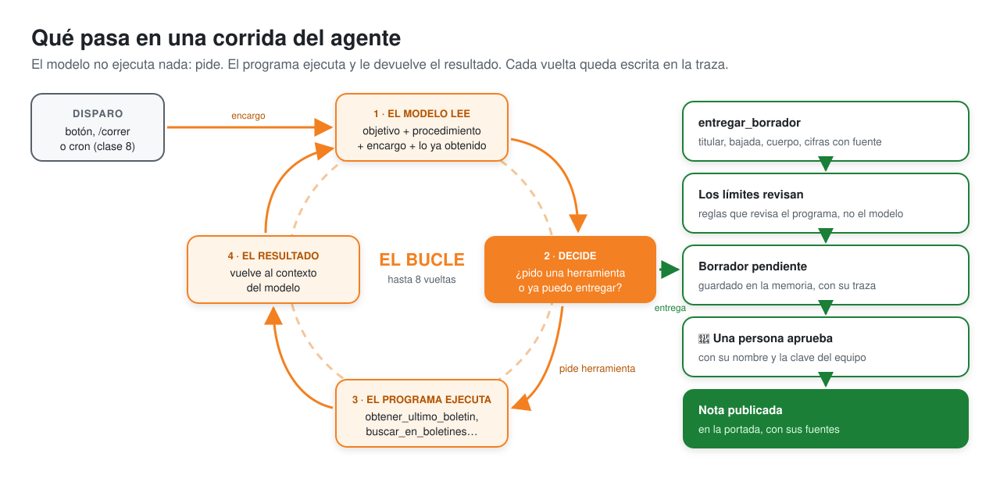

En el ensayo, la traza fue:

| # | Tipo | Qué dice |
|---|---|---|
| 1 | encargo | Hoy es 22 de octubre de 2026. Corrida disparada por: una persona (botón)… |
| 2 | herramienta | El modelo pidió `obtener_ultimo_boletin({})` |
| 3 | resultado | `obtener_ultimo_boletin` devolvió el boletín 335 (INE en vivo; tasa 9,6%) |
| 4 | fin | El modelo entregó con `entregar_borrador`. |
| 5 | limite | Los límites no encontraron problemas. |

✅ **Punto de control:** el borrador tiene `titulo`, `cifras` (cada una con su `fuente`) y `"modelo":
"gemini-…"`. Si sale `{"error": "Ya hay una corrida en curso…"}`, espera 20 segundos y recarga.

---

## 4. Vercel: publicar la página

Entra a **vercel.com/new** (o, desde tu panel de Vercel, **Add New… → Project**).

### 4.1 Importar tu repositorio

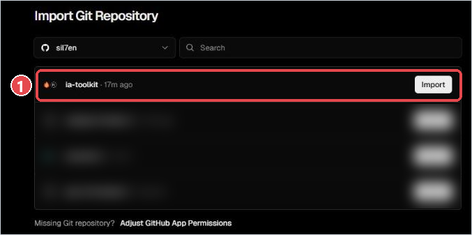

En **Import Git Repository**, busca la fila **ia-toolkit** ① y aprieta **Import**.

> Si `ia-toolkit` no aparece, aprieta **Adjust GitHub App Permissions** (debajo de la lista), agrega
> `ia-toolkit` a los repositorios permitidos, guarda y vuelve a esta página.

### 4.2 Elegir solo la carpeta `frontend`

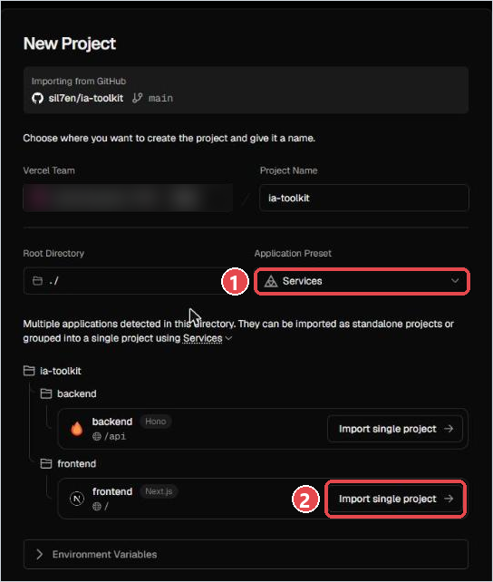

Vercel encuentra dos aplicaciones en tu repositorio (`backend` y `frontend`) y propone juntarlas
(**Application Preset: Services** ①). **No aprietes Deploy en esta pantalla.** En la fila **frontend**, aprieta
**Import single project** ②.

### 4.3 La dirección de tu agente

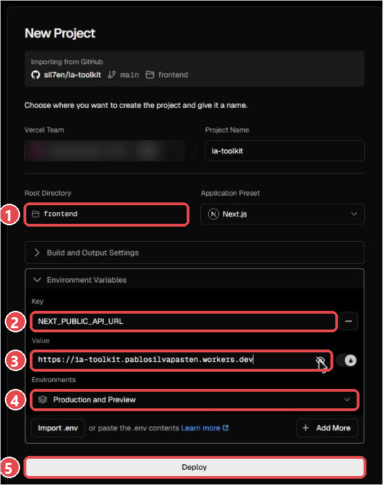

1. Comprueba que **Root Directory** diga `frontend` ① y **Application Preset**, `Next.js`.
2. Abre **Environment Variables** y escribe:
   - **Key** ②: `NEXT_PUBLIC_API_URL`
   - **Value** ③: la dirección de tu agente que copiaste en el paso 1.6, **sin barra al final**. Por ejemplo
     `https://ia-toolkit.tu-subdominio.workers.dev`. El valor se ve con puntitos: aprieta el ojo 👁 para
     revisarlo.
3. Deja **Environments** ④ en **Production and Preview**.
4. Aprieta **Deploy** ⑤.

### 4.4 Esperar y copiar la dirección (alrededor de 40 segundos)

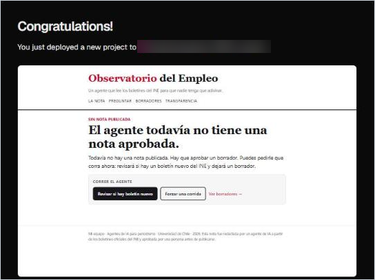

Cuando aparece **Congratulations!** con una miniatura de tu página, ya está publicada. Aprieta
**Continue to Project**.

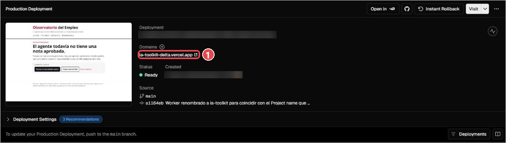

Tu dirección es la que aparece en **Domains** ①. Vercel le agrega una palabra al azar si `ia-toolkit` ya está
tomado (en el ensayo fue `ia-toolkit-delta.vercel.app`). Usa siempre la de **Domains**, no la larga de
**Deployment**.

✅ **Punto de control (en el teléfono):** abre tu dirección de Vercel. Aprieta **Forzar una corrida** ①: en unos
20 segundos aparece el aviso verde y la traza del agente ②.

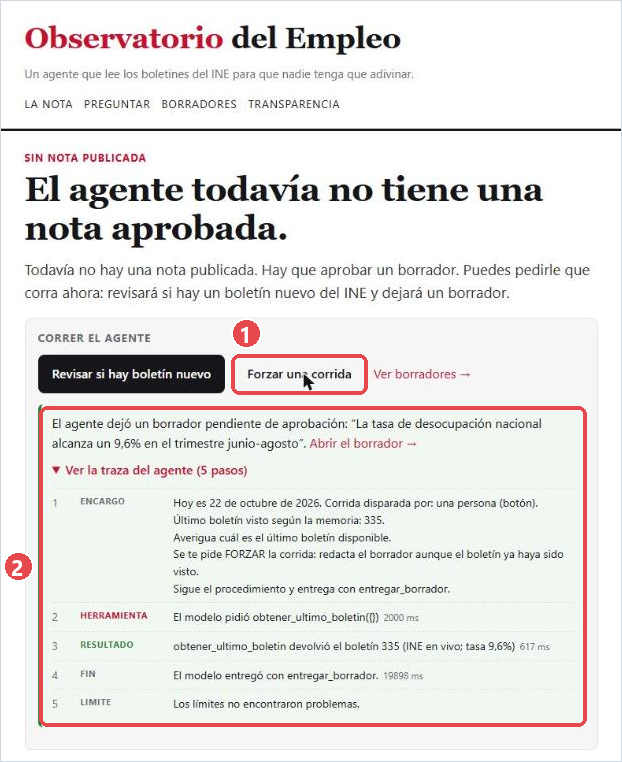

Después:

1. **Borradores** → abre el borrador → escribe tu nombre y la clave de aprobación → **Aprobar y publicar**.
2. **La nota**: aparece publicada, con sus cifras y fuentes.
3. **Preguntar**: escribe una pregunta; la respuesta trae fuentes.

> Si la portada dice **"Falta la variable NEXT_PUBLIC_API_URL"** o **"No pude hablar con el backend"**: en
> Vercel, **Settings → Environment Variables**, corrige el valor (sin barra final) y luego **Deployments** → ⋯
> del último deploy → **Redeploy**. La página lee esa variable al construirse, por eso hay que volver a desplegar.

---

## 5. Anota tus direcciones

En tu fork, abre `README.md`, aprieta el lápiz ✎, completa la sección **Mis direcciones** al final y aprieta
**Commit changes**. Ese commit además prueba que Cloudflare y Vercel vuelven a desplegar solos.

---

## Resultado del ensayo (22-10-2026)

| Paso | Resultado |
|---|---|
| Build de Cloudflare (Workers Builds) | 47 s: inicialización 5 s, clonado 2 s, instalación 18 s, despliegue 25 s. Node 24 y npm 10 detectados solos; `.npmrc` respetado. |
| `GET /` recién desplegado | `en línea`, modelo simulado |
| `/correr?forzar=1`, modelo simulado | 8 s |
| `/correr?forzar=1`, Gemini, motor `propio` | 25 s, `gemini-3.6-flash`, 6 cifras con fuente, sin problemas en los límites |
| `/correr?forzar=1`, Gemini, motor `adk` | 26 s, `gemini-3.6-flash`, 5 cifras con fuente, sin problemas en los límites |
| `/preguntar` (Gemini) | 6–10 s; la pregunta por una comuna responde "no consta" |
| Deploy de Vercel | ~40 s. Vercel detecta `backend` (Hono) y `frontend` (Next.js) y propone *Services*; con **Import single project** en `frontend` queda Root Directory `frontend` y preset Next.js solos. Environments viene en *Production and Preview*. |
| Portada en Vercel → **Forzar una corrida** | 18–20 s, borrador y traza de 5 pasos en pantalla |
| Aprobar desde **Borradores** con nombre y clave | La nota queda publicada en `/nota` y en la portada |
| Commit en `main` | Cloudflare (47 s) y Vercel (14 s) redespliegan solos; los secretos se conservan |
| Jules: issue con plantilla y etiqueta `jules` | Comentario a los 15 s; PR a los ~4 min; CI y Cloudflare en verde |
| Vista previa del PR (con 2b) | Gemini usa `calcular_variacion` 4 veces en una corrida de 22 s |
| Sync fork (simulado con git, sin segunda cuenta) | Sin conflictos con ediciones típicas del estudiante |
| Diferencias con la documentación oficial | El flujo se llama **Create app / Create application** (no "Import a repository"); el directorio raíz se llama **Path** y está dentro de **Advanced settings**; los secretos se agregan después del primer deploy. En Vercel no hay botón **Edit** en Root Directory: se usa **Import single project**. |
